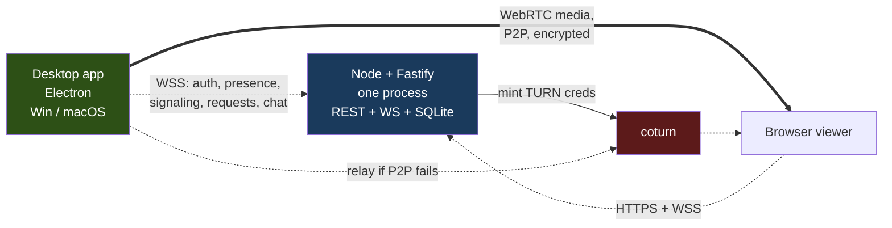
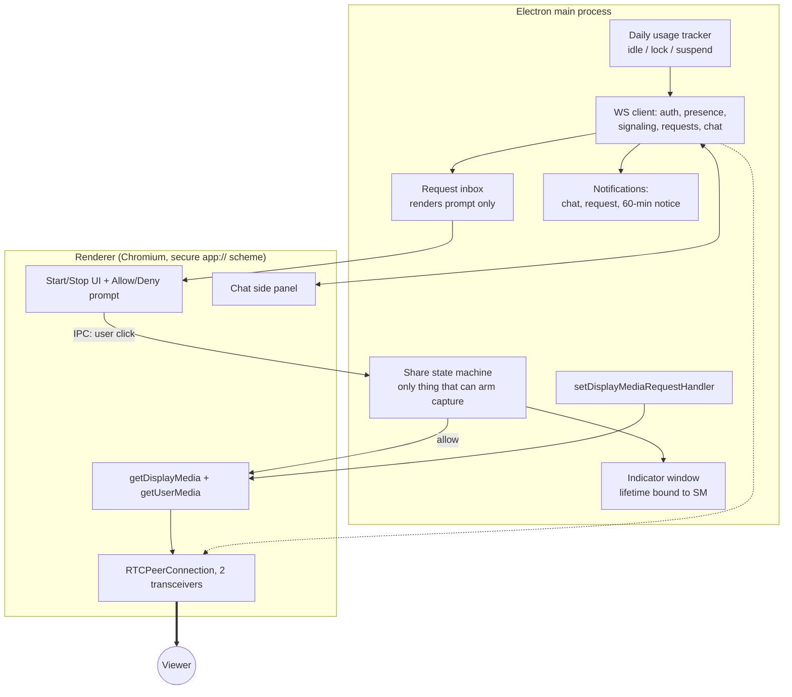
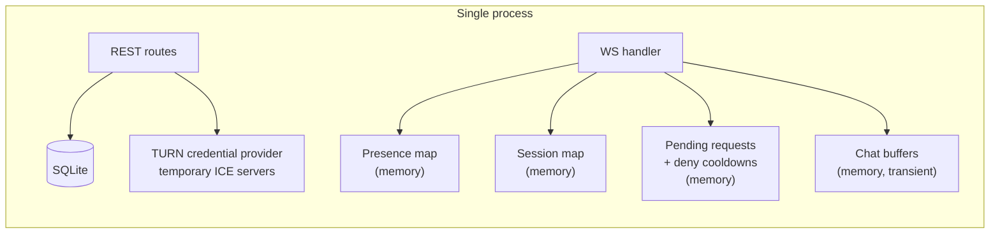
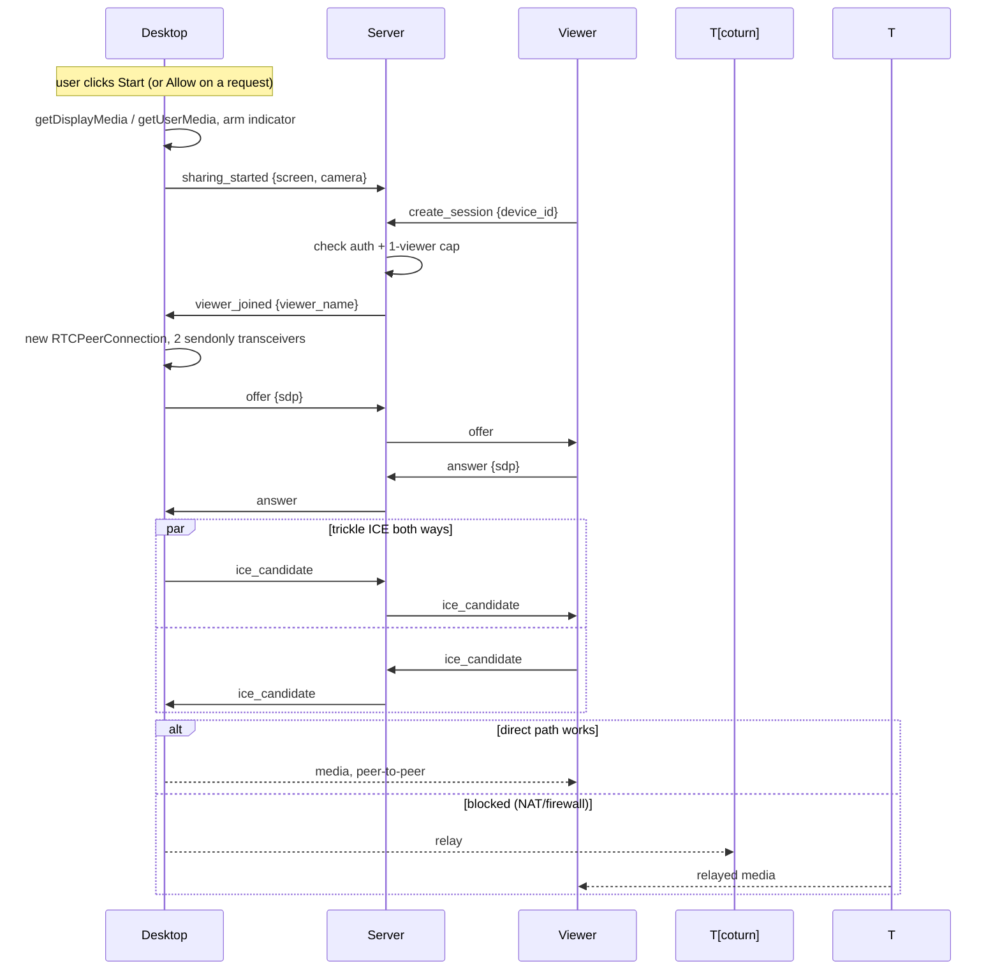
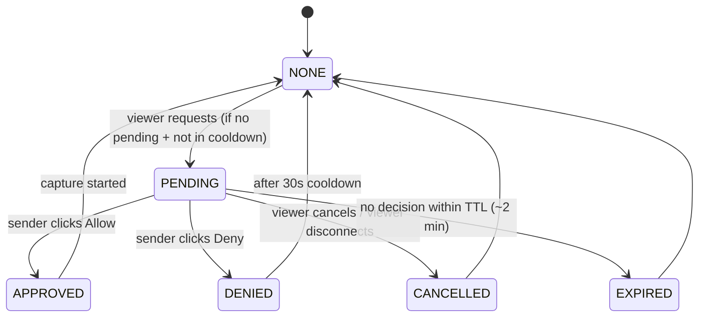

# Presence & Screen Sharing — MVP Architecture

Open-source, self-hostable, consent-based live presence/screen-sharing. Windows + macOS desktop sender, browser viewer. One VPS. No mobile.

---

## 1. Architecture Overview



Two planes, kept separate on purpose:

- **Control plane** (dotted): auth, presence, signaling, viewer screen/camera **requests**, and **text chat** — a few KB/min, all through one server.
- **Media plane** (solid): pixels — peer-to-peer whenever possible, DTLS-SRTP encrypted end to end. The application server (`S`) never terminates or stores this media. When TURN (`T`) is needed as a fallback, it relays the encrypted stream between the two endpoints without the keys to decrypt it — see §11 for exactly what that does and doesn't expose.

**Why this shape:** the server's only job is introducing two peers, relaying small consent/chat messages between them, and getting out of the way. Everything else (recording, history, multi-viewer) is explicitly out of scope, so there's nothing else for the server to do.

Chat and viewer requests ride the **control plane, not WebRTC**. They're a few hundred bytes each, and both must work whether or not a media session exists — that's the whole point of a screen request, and it's equally true of chat: an authorized viewer can message the sender with screen and camera both off. Putting them on the existing authenticated WebSocket avoids inventing a data-channel lifecycle that would have to be negotiated before it could be used, and it keeps their lifetime tied to the control relationship rather than to any particular share session.

**The single most important property of this system is §5's consent invariant:** a viewer can *ask*, and only the sender can *arm capture*. Read that section before changing anything in the control plane.

---

## 2. Technology Choices

| Layer | Choice | WHY | TRADE-OFF |
|---|---|---|---|
| Desktop | **Electron** | Chosen for lower implementation risk on this MVP. Chromium ships `desktopCapturer`/`setDisplayMediaRequestHandler` (screen) and `getUserMedia` (camera/mic) plus a complete, production-grade WebRTC stack — all as documented JS APIs, on both OSes, with no platform-specific capture code to write. Tauri is a credible alternative in principle, but its macOS webview (WKWebView) has historically needed more platform-specific work to reach equivalent screen-capture/WebRTC functionality, which is more implementation risk than this MVP needs — verify current WKWebView support if you revisit this later. | ~150MB install, ~150–250MB RAM. Irrelevant for a two-person desktop tool. |
| Backend | **Node + Fastify, one process** | REST + WebSocket + SQLite in one deployable unit. Shared TypeScript types between server and Electron app. | Not horizontally scalable — fine, you don't need it to be. |
| Signaling | **`ws` library**, hand-rolled routing | ~150 lines. Socket.IO's rooms/reconnection abstractions fight an explicit presence state machine more than they help. | You write reconnect logic yourself — but you need custom reconnect logic anyway (see §10). |
| DB | **SQLite** (better-sqlite3 + Drizzle) | Zero ops, file-based, trivial to back up (`cp`). At this scale, faster than networked Postgres. | Couples you to a persistent disk — fine on one VPS. |
| Media | **WebRTC, P2P, 1 viewer** | Zero media cost when direct; lowest latency. | 2+ viewers needs an SFU — **NOT NEEDED FOR MVP**. |
| TURN | **Cloudflare Realtime temporary ICE servers** for the active MVP; self-hosted coturn remains an optional deployment path | No permanent TURN credentials reach clients; direct ICE avoids relay bandwidth when possible. | Cloudflare is an external provider; live self-hosted coturn validation remains a deployment task. |
| Reverse proxy | **Caddy** | Automatic HTTPS via Let's Encrypt, one-file config. | None worth mentioning. |
| Deployment | **One VPS + Docker Compose** | Everything in one place, backs up as one thing, migrates as one thing. | No redundancy — acceptable for two users. |

**NOT NEEDED FOR MVP:** Redis, message queues, Kubernetes, microservices, SFU, multi-region, event sourcing, RBAC, analytics.

---

## 3. Desktop Architecture



**WHY a state machine in main, not the renderer:** it's the single thing that can authorize capture, and its indicator window shares the same object lifetime as the capture handles — so "capture running, indicator hidden" isn't a bug to prevent, it's a state that doesn't exist in the code. This is the load-bearing design decision for consent.

Note the shape of the request path in the diagram: an incoming viewer request reaches the **request inbox**, which can only render a prompt in the UI. There is no edge from `WS` or `REQ` into `SM`. The only arrow into the share state machine comes from a user click. See §5.

**Separate screen + camera tracks, not composited.** Independent bitrate/fps tuning, viewer can hide/resize camera, and stopping the camera is `replaceTrack(null)` with **no renegotiation** — the single biggest complexity-reduction in the whole design, since full renegotiation is where WebRTC implementations most often break. Both transceivers are reserved at connection setup (§5) so that *turning a track on* mid-session is equally cheap.

### Electron security baseline

Not a redesign, just the settings the app is built with from the first commit. These are cheap on day one and expensive to retrofit:

```js
new BrowserWindow({
  webPreferences: {
    nodeIntegration: false,
    contextIsolation: true,
    sandbox: true,        // where compatible with the preload in use
    webSecurity: true,
    preload: /* typed IPC bridge, allowlisted channels only */
  }
})
```

- **Restrictive CSP** on the `app://` origin: no `unsafe-eval`, no remote script origins, `connect-src` limited to your own API/WSS origin and the STUN/TURN endpoints.
- **Restricted navigation:** deny `will-navigate` and `setWindowOpenHandler` for anything outside `app://`; external links go to the system browser.
- **IPC sender validation:** every `ipcMain.handle` checks `event.senderFrame` is the app's own top-level frame before acting. The `arm capture` channel in particular is validated here, because it is the channel the entire consent model rests on.
- **Controlled custom origin:** the renderer is served from a registered privileged `app://` scheme. This is the security recommendation for this app specifically — it gives the renderer a stable, controlled origin to write CSP and navigation rules against, and to register before `app.whenReady()` (see below).

### Windows vs macOS

| | Windows | macOS |
|---|---|---|
| Screen capture | `desktopCapturer` — no OS permission prompt at all | Same API, but **System Settings → Screen Recording** permission required; **app must be fully quit and relaunched** after granting — toggling alone doesn't take effect |
| Recurring re-auth | None | macOS screen-recording permission should be modeled as **revocable/expirable at the OS's discretion at any time** — don't assume a one-time grant lasts forever. **NEEDS PROTOTYPE:** confirm current re-authorization behavior *and the actual failure signal* on your target macOS version before assuming either an interval or a specific symptom (see "Detecting lost permission" in §5) |
| Camera/mic | `getUserMedia`, standard prompt | `getUserMedia` + `NSCameraUsageDescription`/`NSMicrophoneUsageDescription` in Info.plist (shown to the user — write them honestly) |
| Capture indicator | **None provided by the OS** — your in-app indicator is the only signal | Orange/purple menu-bar dot (in addition to yours) |
| Idle / lock signals | `powerMonitor` idle time + `lock-screen`/`unlock-screen`, `suspend`/`resume` | Same `powerMonitor` API surface; verify lock events on your target version |
| Known capture gaps | DRM content renders black; UAC prompts aren't captured | — |

`getUserMedia`/`getDisplayMedia` require a **secure context**. Register the privileged `app://` scheme before `app.whenReady()` and serve the renderer from it — doing this from the start avoids a class of bugs where camera/screen APIs behave differently in dev versus a packaged build.

### Sender UI surfaces

Four small surfaces, all in the desktop app:

1. **Indicator window** — always-on-top, frameless, lifetime bound to the capture handles (§11). Shows what is live and who is watching:

   ```
   🔴 Sharing Active
   👁 Amit is watching
   Screen: ON   Camera: OFF
   [ Stop Sharing ]
   ```

   When the viewer disconnects, the watcher line becomes `Amit stopped watching` and then clears; the sharing state itself is unaffected (§10 grace period).

2. **Request prompt** — raised on an incoming viewer request:

   ```
   Amit wants to view your screen.
   [ Allow ]   [ Deny ]
   ```

3. **Chat notification + side panel** — an OS notification on an incoming message; clicking it opens the panel docked beside the app window:

   ```
   +----------------------------------+------------------+
   |                                  | CHAT             |
   |        User's Desktop            |                  |
   |                                  | Amit: Hello      |
   |                                  | Rahul: Hi        |
   |                                  |                  |
   |                                  | [Type message]   |
   |                                  |            Send  |
   +----------------------------------+------------------+
   ```

4. **60-minute awareness notice** — fires once per continuous sharing session (§9). It is a notification, not a prompt: there is no button on it, and nothing stops.

### Daily active usage tracker

A small main-process module that answers exactly one question: roughly how many minutes has this computer been actively used **today**, in the device's local timezone.

```
Rahul
● Online

Today's active usage:
3h 42m
```

**How it's measured.** Poll `powerMonitor.getSystemIdleTime()` on a fixed tick (15s). If the system has been idle beyond the idle threshold (default 5 minutes), the tick doesn't count. Subscribe to `suspend`/`resume` and `lock-screen`/`unlock-screen` and stop counting between them. This is deliberately approximate — it's an "are they at the machine" figure, not timesheet data.

**What it stores.** One tiny local file, overwritten in place:

```json
{ "local_date": "2026-09-18", "active_seconds": 13320 }
```

When a tick observes a different local date than the stored one, the counter resets to zero for the new date. The previous day's number is **overwritten, not archived** — there is no yesterday in this design and no table anywhere that could accumulate one.

**Owner privacy toggle.** A device-local setting, `Share today's active usage time with authorized viewers` (ON/OFF). When OFF, the device simply omits `active_usage_seconds` from its presence payload — the server has nothing to withhold because it never receives it. The setting is stored with the device's local config, **not** as a server-side column: the device is the authority over its own measurement and the only party that needs to enforce it.

**Known limitations, documented on purpose:** usage only accrues while the desktop app is running, and idle/lock detection is best-effort and differs slightly between the two OSes. Both are acceptable for an aggregate figure and neither justifies deeper instrumentation.

**NOT TRACKED, by design:** applications, window titles, websites, URLs, keystrokes, screenshots, per-app or per-hour breakdowns, any timeline. The only value that exists is a single integer for the current local day.

---

## 4. Backend Architecture

One Fastify process. Presence, active sessions, pending requests and chat buffers live **in memory**; only durable identity data touches SQLite.



| In memory (gone on restart — by design) | In SQLite |
|---|---|
| Which devices are connected | users, devices, credentials, sessions (login), viewer_permissions |
| Active share sessions, who is currently watching | `devices.last_seen_at` (one overwritten column) |
| Pending screen/camera requests + per-kind deny cooldowns | — |
| Transient chat buffer per active relationship (independent of media state — see §9) | — |
| Last reported `active_usage_seconds` per device | — |
| WS connections, rate-limit counters | — |

A restart drops everyone; clients reconnect with backoff (§10). This isn't a shortcut around building reconnect logic — it's the reason to build it early, since it now runs on every deploy. A restart also clears pending requests, cooldowns and the chat buffer, which is the correct behavior: a stale consent prompt should never survive a deploy.

---

## 5. WebRTC Flow

### THE CONSENT INVARIANT

A server→device **request** message exists in the protocol. It can do exactly one thing: deliver a request to the sender's UI so a human can look at it. It cannot arm, start, resume or extend capture, and no code path connects it to the share state machine.

```
Viewer clicks [ Request Screen ]
        ↓
Server checks viewer_permissions, pending-state, cooldown
        ↓
Sender's device receives the request  ──►  renders a prompt. Nothing else happens.
        ↓
Sender sees  [ Allow ]  [ Deny ]
        ↓
Sender clicks Allow
        ↓
Trusted Electron IPC, validated sender frame, originating in a user gesture
        ↓
Main-process share state machine
        ↓
Capture starts, indicator window comes up with it
```

**Without a sender Allow: no screen capture, no camera capture.** Not "capture that stops quickly", not "capture with a warning" — the `getDisplayMedia`/`getUserMedia` call is never reached.

The guarantee is therefore **not** "no such message exists" (it does now). It is:

> Every path that can arm capture terminates at the main-process share state machine, and the state machine accepts arm input from exactly one source: a validated IPC call from the app's own top-level frame, triggered by a user click. Network input has no route into it.

That is a narrower guarantee than the protocol-absence argument it replaces, and it is worth being honest about the difference: it is enforced by one reviewable boundary in `/apps/desktop/main` rather than by the protocol's shape. Keep that boundary small, keep it free of convenience shortcuts, and never add an "auto-allow trusted viewer" option — that option is the entire product's threat model, inverted.

**Sender always creates the offer.** No `RTCPeerConnection` exists until a human has clicked, so the server cannot cause one to come into being.

### Session flow



### Two transceivers, reserved up front

At offer time the sender adds **both** transceivers — screen and camera — in `sendonly` direction, even when only one of them has a live track. The unused slot carries a null track.

```js
const screenTx = pc.addTransceiver(screenTrack ?? "video", { direction: "sendonly" });
const cameraTx = pc.addTransceiver(cameraTrack ?? "video", { direction: "sendonly" });
```

**WHY:** a viewer can now request the camera *after* screen sharing is already live (§7 partial states). If the camera transceiver didn't exist yet, honoring that request would mean adding a track to an established connection and running a full renegotiation — exactly the operation §3 avoids. With the slot reserved, turning the camera on is `cameraTx.sender.replaceTrack(cameraTrack)` and turning it off is `replaceTrack(null)`, symmetric and renegotiation-free. The cost is one inactive m-line in the SDP.

**Track identity: the viewer must be able to tell which received track is which.** With two same-kind (`video`) transceivers, the viewer cannot assume ordering in `ontrack` events is stable across browsers or renegotiations, so identity has to be pinned deliberately rather than inferred:

- The sender creates the two transceivers in a **fixed, always-the-same order** (screen first, then camera) and never removes or reorders them for the life of the connection — only `replaceTrack` is used to turn a feed on or off.
- Each transceiver's **`mid`** (the SDP media identification tag, stable for the connection's lifetime once negotiated) is treated as the canonical identity. On `viewer_joined`/renegotiation, the sender includes a small `{ mid, kind: "screen" | "camera" }` mapping in the signaling payload so the viewer can bind `ontrack`'s `event.transceiver.mid` to the right label without guessing from track order or label strings.
- This needs no new infrastructure — it's a couple of extra fields in the existing offer/answer exchange (§7) — and it means a browser that reorders `ontrack` callbacks, or a track that starts `null` and only appears later via `replaceTrack`, still ends up rendered in the correct screen/camera slot in the viewer UI.

Whenever the live set changes mid-session, the sender emits `sharing_updated {screen, camera}` so the viewer's UI (and its Request buttons) follow the real state.

**STUN:** configurable via environment variable — default to a public STUN server, but let the deployer point it anywhere. Keep the implementation simple: STUN carries no media and needs no credentials, so this is a one-line config value, not a subsystem.

**ICE policy and TURN — when it is actually used:** normal connections use
`iceTransportPolicy: "all"` with host, STUN server-reflexive, and temporary
Cloudflare TURN relay candidates. ICE normally prefers a viable direct
host/server-reflexive pair, so media stays peer-to-peer when the network allows
it. TURN is used only when direct ICE connectivity cannot establish a viable
path — typically with symmetric NAT, CGNAT, or a network that blocks UDP
outright (corporate/campus firewalls). How often that happens depends entirely
on the networks involved, so don't design around a fixed percentage. **You
cannot ship without a TURN fallback regardless** — without one, any connection
that can't hole-punch simply fails with no diagnosable cause. A configured
relay candidate is not proof that media used TURN; the selected candidate pair
must be checked through WebRTC statistics.

**Network change (Wi-Fi → hotspot, VPN toggle):** sender calls `createOffer({iceRestart: true})` on `iceConnectionState === "failed"` or `"disconnected"` past ~8s. Re-gathers candidates, typically recovers in 3–8s, **no re-permission prompt**.

**Laptop sleep/wake:** `powerMonitor.on("suspend")` → send `going_offline`, temporarily interrupt sharing and close the PC cleanly (viewer sees Offline in <1s instead of after a timeout). On `resume`: reconnect the control plane and automatically reconnect the **already-approved active sharing session**, then resume that sharing session without a button click or fresh consent and show `Connected / Sharing resumed`. This automatic resume applies only to that already-approved active session; sleep/wake never approves or resumes a new viewer request. If the app crashes or is relaunched, sharing still returns to IDLE and requires a fresh explicit local user action (§9).

**Detecting lost screen permission (macOS):** prefer real signals where the platform gives them — track `onended`/`onmute`, `getDisplayMedia` rejection on the next start attempt, and any error surfaced by the capture API. Treat **black-frame detection as a supplementary fallback only**, not as the primary mechanism and not as guaranteed behavior on every macOS version. Whatever the signal, the sender-facing outcome is the same: stop cleanly, and show a clear message explaining that screen-recording permission must be re-granted and the app relaunched. **NEEDS PROTOTYPE** on your actual target macOS version to find out which signals you actually get.

**Capture stops unexpectedly (source window closed, camera unplugged):** the track fires `onended` — release that track, `replaceTrack(null)` on its transceiver, emit `sharing_updated`, and notify the viewer rather than leaving a frozen frame. If the other track is still live, the session continues.

---

## 6. TURN (coturn)

```
Internet
  │
  ├─ 443/tcp  (HTTPS+WSS) ──> Caddy ──> Fastify
  │
  ├─ 3478/udp + 3478/tcp  ──> coturn   (NOT behind Caddy — see below)
  ├─ 5349/tcp (TLS, turns:) ──> coturn
  ├─ relay UDP range (e.g. 49160–49200) ──> coturn
  │
  └─ UDP (ephemeral range) ──> WebRTC P2P, directly between peers
```

**Do not put coturn behind Caddy.** TURN needs raw UDP relay across a configured port range and its own TLS on 5349 for `turns:`; an HTTP reverse proxy adds nothing and actively can't forward that traffic correctly. Give coturn its own public ports.

**Minimum correct configuration:**

```
listening-port=3478
tls-listening-port=5349
listening-ip=0.0.0.0
external-ip=<PUBLIC_IP>        # and <PUBLIC_IP>/<PRIVATE_IP> behind cloud NAT
realm=<your-domain>
min-port=49160
max-port=49200
use-auth-secret
static-auth-secret=<from .env>
user-quota=... total-quota=... max-bps=...
no-multicast-peers
```

`external-ip` is the field that quietly breaks everything when wrong behind cloud NAT: candidates are advertised with an unreachable address and connections fail only for the users who actually need the relay. Keep the relay range open in the firewall and matched between `turnserver.conf` and the VPS security group.

**Credentials — do this correctly, it's the one place a misconfiguration costs money:** never static creds. The self-hosted coturn deployment uses `use-auth-secret` mode:

```
username = "<unix_expiry>:<user_id>"
password = base64(HMAC-SHA1(shared_secret, username))
```

10-minute TTL, minted by the API only for authenticated users. Set coturn's `user-quota`, `total-quota`, `max-bps` — this bounds the damage if a credential leaks regardless.

The active MVP provider is Cloudflare Realtime. The Phase 4 server calls its
authenticated `generate-ice-servers` endpoint to issue temporary STUN/TURN
configuration; the permanent Cloudflare API token and key ID remain
server-side, and responses are validated and marked `no-store`. Cloudflare's
provider-side credential, quota, and bandwidth controls apply to this path;
the application does not expose a permanent provider secret or configure
coturn quotas for Cloudflare.

Self-hosted coturn remains an optional, separate deployment path in the
documented one-VPS Docker Compose architecture. It uses temporary HMAC
credentials derived from `TURN_SHARED_SECRET`, scoped by `TURN_REALM`, with
`user-quota`, `total-quota`, `max-bps`, `no-multicast-peers`, and the bounded
relay port range applied by the Compose service. These coturn-specific quotas
and controls do not apply to the active Cloudflare provider. The current
automated relay evidence is for Cloudflare; the normal automated path uses
`iceTransportPolicy: "all"` and verifies the selected candidate pair, while a
forced-relay test uses `iceTransportPolicy: "relay"`. Live self-hosted coturn
connectivity and its deployment acceptance criteria remain outstanding.

**Forced-relay test is mandatory, not optional.** Run the full flow with `iceTransportPolicy: "relay"` on both ends (§15, item 8) during Phase 4. It's the only way to find out your TURN config is wrong before a user on a hostile network does.

Cloudflare Realtime is used by the current Phase 4 implementation as a
temporary credential provider for integration validation. It is not an SFU
and does not replace the documented self-hosted coturn deployment target.

---

## 7. Signaling Protocol

One WebSocket, one JSON envelope:

```json
{ "type": "offer", "session_id": "sess_abc", "payload": { } }
```

### Presence, media and signaling

| Type | Direction | Payload (example) |
|---|---|---|
| `auth` | client→server, **must be first frame** | `{ "token": "..." }` |
| `presence` | server→viewer | `{ "device_id": "d1", "state": "online", "screen": false, "camera": false, "active_usage_seconds": 13320 }` |
| `sharing_started` | device→server→viewer | `{ "device_id": "d1", "screen": true, "camera": false }` |
| `sharing_updated` | device→server→viewer | `{ "device_id": "d1", "screen": true, "camera": true }` |
| `sharing_stopped` | device→server→viewer | `{ "reason": "user" }` |
| `create_session` | viewer→server | `{ "device_id": "d1" }` |
| `viewer_joined` | server→device | `{ "session_id": "s1", "viewer_user_id": "u2", "viewer_name": "Amit" }` |
| `viewer_left` | server→device | `{ "session_id": "s1", "viewer_user_id": "u2", "reason": "closed" }` |
| `offer` / `answer` | relayed opaquely | `{ "session_id": "s1", "sdp": "...", "track_map": [{"mid":"0","kind":"screen"},{"mid":"1","kind":"camera"}] }` |
| `ice_candidate` | relayed opaquely, both ways | `{ "session_id": "s1", "candidate": {...} }` |
| `error` | server→client | `{ "code": "NOT_AUTHORIZED" }` |

`active_usage_seconds` is **omitted entirely** when the device's privacy toggle is OFF (§3). Absent means "not shared", and the viewer UI shows nothing rather than a zero.

`viewer_joined` / `viewer_left` carry the viewer's display name so the sender's indicator can show *who* is watching (`👁 Amit is watching`). This is live state only; nothing about it is written down (§8).

### Viewer requests

| Type | Direction | Payload (example) |
|---|---|---|
| `share_request` | viewer→server→device | `{ "request_id": "rq_1", "kind": "screen", "viewer_user_id": "u2", "viewer_name": "Amit" }` |
| `share_request_cancel` | viewer→server→device | `{ "request_id": "rq_1" }` |
| `share_request_decision` | device→server | `{ "request_id": "rq_1", "decision": "allow" }` |
| `share_request_state` | server→viewer | `{ "request_id": "rq_1", "kind": "screen", "state": "DENIED", "cooldown_until": 1758200000 }` |

`kind` is `"screen"` or `"camera"`. The server enforces one pending request per `(viewer, device, kind)` and the 30s post-deny cooldown before relaying anything (§9); a request that violates either is answered with `share_request_state` rather than forwarded, so the sender is never prompted twice for the same thing.

**`share_request` arriving at the device renders a prompt and nothing else.** See §5.

### Chat

| Type | Direction | Payload (example) |
|---|---|---|
| `chat_message` | viewer↔server↔device | `{ "from_user_id": "u2", "from_name": "Amit", "text": "Are you there?", "sent_at": 1758199000 }` |

- Delivered only between a device owner and a viewer with a live `viewer_permissions` row, both currently connected.
- **Not scoped to a media `session_id`.** Chat is keyed by the (owner, viewer) relationship, not by a share session, so it works whether screen/camera sharing is on, off, or was never started this visit — a viewer can arrive, chat, and request screen/camera before anything is shared.
- **Limits:** `text` ≤ 1000 characters; ~1 message/second sustained with a small burst allowance; oversize or over-rate messages are rejected with `error` and not relayed. Text is treated as text — rendered as plain strings in both UIs, never as HTML.
- Buffer lifetime and non-persistence: §8 and §9.
- No attachments, no voice, no reactions, no typing indicators, no group chat, no read receipts.

**WHY relay SDP/ICE opaquely instead of parsing them server-side:** keeps you out of a whole class of parsing bugs, and browser SDP changes never break your server. Requests and chat are the opposite case — the server *must* inspect those, because it's the thing enforcing authorization, pending-state and rate limits.

**Don't put the auth token in the WS URL** — it ends up in proxy/access logs. Send it as the first frame instead, with a 5s deadline to authenticate before the connection is dropped.

---

## 8. Database Schema

Six tables. **What's excluded matters more than what's included.**

```sql
users (id, email, created_at)

auth_tokens (id, user_id, token_hash, expires_at, consumed_at)
  -- magic-link style login tokens; SHA-256 hashed, single-use, 15 min TTL

sessions (id, user_id, token_hash, expires_at, revoked_at, created_at)
  -- LOGIN sessions only: the server-side record behind the browser's opaque
  -- session cookie (§9). Enables instant revocation.
  -- This is authentication state. It is NOT share-session history and must
  -- never be extended into one.

devices (id, user_id, name, platform, revoked_at, last_seen_at)
  -- last_seen_at is ONE overwritten column, not a log

device_credentials (id, device_id, refresh_token_hash, family_id, revoked_at)
  -- rotation + reuse-detection lineage

viewer_permissions (id, owner_user_id, viewer_user_id, revoked_at)
  -- who may watch whom; either side can revoke
  -- AUTHORIZATION ONLY — not consent to capture. See §9.
```

**ACTIVE RUNTIME STATE (memory, not DB):** presence, active share sessions, who is currently watching, pending requests and deny cooldowns, chat buffers, last reported daily usage value.

**PERSISTENT STATE (DB):** identity, credentials, login sessions, who's allowed to view whom, one `last_seen_at` timestamp.

**DEVICE-LOCAL STATE (neither server memory nor server DB):** today's `{ local_date, active_seconds }` counter and the usage-sharing toggle (§3).

**Explicitly NOT stored, anywhere:**

- screen/camera frames, thumbnails, recordings;
- **any table logging share-session start/stop times** — that table would *be* the surveillance history this product exists to avoid, and it tends to arrive disguised as "just for debugging";
- **viewer-watch history** — who watched whom and when;
- **chat history** — messages exist in a memory buffer and then they're gone;
- **usage history** — one integer for today, overwritten; no per-day rows, no timeline.

If you want diagnostics later, count into a metrics counter with no timestamps or user IDs attached.

Each of the four excluded tables is individually tempting and individually reasonable-sounding. The reason to refuse all four is that the product's privacy claim is only as strong as its schema: anything in the schema can be queried, subpoenaed, leaked or quietly repurposed, and nothing that doesn't exist can be.

---

## 9. Authentication, Consent & Sessions

**Humans:** magic-link email. No passwords to store or reset. Token = 32 random bytes, stored as SHA-256, 15-min TTL, single use. Login session = opaque cookie (`httpOnly`, `Secure`, `SameSite=Strict`) mapped to a row in the `sessions` table (§8) — not a JWT, because you want instant revocation and a JWT blocklist is just server-side session state with extra steps.

**Devices:** one-time enrollment code (generated in the browser while logged in, entered in the desktop app) → device row + refresh token, stored in the OS keychain (`safeStorage` on Electron), never a plain file. Refresh tokens **rotate on every use**; if a *retired* token is ever presented again, revoke the whole token family — that's the signal of theft or a race, and it bounds a stolen credential to one detectable use.

**Viewer authorization:** for MVP, viewers are **pre-authorized directly in `viewer_permissions`** — there's no real-time pairing-code workflow for *becoming* an authorized viewer. In practice: the owner (or a simple admin/CLI action, since there's no self-service multi-tenant signup in scope) inserts a `viewer_permissions` row linking a `viewer_user_id` to an `owner_user_id`. The viewer signs in normally via magic link, and once that row exists they can see that owner's presence, chat, and *ask* to view screen or camera; either side can revoke it at any time. A self-service pairing flow for adding new authorized viewers is a reasonable post-MVP addition if the user base grows beyond people the owner already knows.

### AUTHORIZATION vs CONSENT

These are two different things and the document uses two different words for them on purpose.

| | **Authorization** | **Consent** |
|---|---|---|
| Stored as | `viewer_permissions` row (SQLite) | Nothing — a click, in the moment |
| Means | "This person is allowed to see my presence and to ask me for screen/camera" | "Yes, right now, start capturing" |
| Granted by | Owner, ahead of time | Owner, per request, live |
| Lifetime | Until revoked | The duration of that sharing session |
| Grants capture? | **No. Never.** | Yes — and only this |

An authorized viewer with a valid permission row who asks for the screen while the owner is at lunch gets exactly one thing: a pending request that times out. `viewer_permissions` is a doorbell list, not a key.

### Share state machine

```mermaid
stateDiagram-v2
    [*] --> IDLE
    IDLE --> STARTING: user clicks Start / user clicks Allow
    STARTING --> SHARING: capture + PC established
    STARTING --> IDLE: permission denied / capture failed
    SHARING --> SHARING: 60-min awareness notice (once) — sharing continues
    SHARING --> SHARING: track added/removed (replaceTrack, no renegotiation)
    SHARING --> STOPPING: user clicks Stop
    SHARING --> STOPPING: network failure (ICE failed, no recovery)
    SHARING --> STOPPING: capture ended by OS/device (all tracks gone)
    SHARING --> IDLE: viewer disconnected, grace period elapsed with no reconnect
    STOPPING --> IDLE
    IDLE --> [*]: app crash — sharing returns to IDLE; never auto-resume on relaunch
    SHARING --> IDLE: sleep — sharing temporarily interrupted
    IDLE --> SHARING: wake/resume — auto-reconnect and resume the existing approved session
```

**There is no session expiry and no renewal flow.** Sharing continues indefinitely — two hours, five hours, a full workday — until one of these happens:

1. the sender clicks **Stop** (the normal way a session ends);
2. capture technically ends (source window closed, camera unplugged, OS permission lost, and no track remains);
3. the app closes or crashes;
4. an unrecoverable network failure terminates it (§10);
5. the viewer disconnects and doesn't return within the grace period.

**The 60-minute threshold is awareness only.** When a continuous sharing session reaches 60 minutes, the desktop app fires **one** notification:

> "Screen sharing has been active for 60 minutes. Sharing is still active."

It has no buttons, it doesn't stop anything, and it doesn't repeat — no hourly nagging in MVP. If the sender stops and later starts a *new* session, that new session gets its own one-time notice. The threshold is read from config (`SHARE_NOTICE_MS`) so dev and test builds can set it to a few seconds instead of waiting 60 real minutes.

**Why dropping the timebox is safe.** The timebox previously guarded one specific failure: a laptop sleeping and waking days later with capture silently still running. That failure is now blocked directly at the resume path instead — **sleep temporarily interrupts sharing, then automatically reconnects and resumes only the already-approved active sharing session**, with an explicit `Connected / Sharing resumed` notification and no fresh consent (§5). A crash or relaunch remains different: it returns sharing to IDLE and requires a fresh explicit local action. Guarding the actual failure beats guarding a clock, and it removes an expiry that interrupted legitimate long sessions for no privacy gain. What keeps this an accountability tool rather than monitoring software is the combination of: the indicator invariant (§11), the consent invariant (§5), the explicit approval required for every new viewer request, the crash/relaunch reset rule, and the absence of any history table (§8).

**Viewer disconnect uses a short grace period, not an immediate stop.** A page refresh or a brief network blip shouldn't interrupt sharing — capture tracks stay live for a grace window (e.g. ~20–30s) after the viewer's connection drops, so a quick reconnect resumes seamlessly, with the chat buffer intact. Only after the grace period elapses with no reconnect does capture stop and the session return to idle.

**Session ID guessing:** WebRTC `session_id`s are high-entropy (≥128-bit random), which on its own makes them impractical to guess — independent of the authorization check that's still required on every signaling message regardless.

### Request state machine

One instance per `(viewer, device, kind)`, kind being `screen` or `camera`. Entirely in server memory.



**Anti-spam rules, both enforced server-side:**

- **One pending request per kind.** While a screen request is PENDING, another screen request from that viewer is rejected. The viewer's UI shows `Screen request pending...` with a Cancel option instead of a live Request button. A camera request is independent and still allowed.
- **30-second cooldown after Deny.** The same kind can't be requested again for 30s; the server returns `share_request_state` with `cooldown_until` and the viewer's button is disabled with a countdown.

APPROVED is a transient state, not a standing grant: it means "the sender clicked Allow and capture is being started for this session." It is consumed immediately and does not survive the session, so a later request goes through the full flow again.

### Partial screen/camera states

The two tracks are independent, so four states exist and the viewer's UI follows them from `presence` / `sharing_started` / `sharing_updated`:

| Sender state | Viewer sees |
|---|---|
| Screen OFF + Camera OFF | `[ Request Screen ]` `[ Request Camera ]` |
| Screen ON + Camera OFF | live screen, `[ Request Camera ]` |
| Screen OFF + Camera ON | live camera, `[ Request Screen ]` |
| Screen ON + Camera ON | both live, no request buttons |

Chat is available in all four rows, including Screen OFF + Camera OFF — an authorized viewer can message the sender and send requests before any media has ever been shared this visit.

Approving a request while a session is already live adds the track via the reserved transceiver (§5) — no renegotiation, no new session, no second indicator.

### Chat buffer lifetime

Chat lifetime is tied to the **authorized owner↔viewer control relationship** — the viewer is connected and `viewer_permissions` is live — **not** to whether screen or camera sharing is currently active. Chat is transient by construction:

- Held in a small in-memory ring buffer per active owner↔viewer relationship, server-side, plus whatever each client has in its own UI state.
- **Available whenever an authorized viewer is connected, independent of media state.** Screen OFF + Camera OFF + viewer connected is a normal, supported chat state — the viewer can talk to the sender and request screen/camera before anything is shared. Media state changes (starting, stopping, or the sender never sharing at all) do not touch the buffer.
- **Survives a brief viewer reconnect** within the existing grace period, so a refresh doesn't wipe the conversation mid-sentence.
- **Cleared** only when the control relationship itself ends: the viewer disconnects permanently (past the grace period with no reconnect), `viewer_permissions` is revoked, or the owner disconnects for good. **Stopping screen or camera sharing does not clear or disable chat** — that's a media-plane event, and the chat buffer doesn't listen for it.
- **Cleared on server restart** — no persistence, no recovery.
- **Never written to SQLite.** There is no chat table (§8) and adding one is not a small change; it's a change in what this product is.

---

## 10. Reliability

| Failure | Behavior |
|---|---|
| WS disconnect | Exponential backoff + jitter (1s→2s→4s...→30s cap). Jitter matters even with two users — without it a server restart is a synchronized reconnect storm. |
| WS reconnect | Re-auth, re-fetch presence. Reset backoff only after 60s stable — a flapping network shouldn't tight-loop. |
| WebRTC/ICE disconnect | Wait ~8s (often self-heals) → ICE restart → if that fails twice, surface a clear error with relay-status shown |
| Internet drop, <10s | No state change beyond a "reconnecting" badge |
| Internet drop, minutes | Device marked offline after ~35s (2 missed 15s heartbeats + slack); full re-session on return |
| Laptop sleep/wake | Graceful `going_offline` + temporary sharing interruption and clean PC close on suspend; on resume, reconnect the control plane and automatically reconnect the **already-approved active sharing session**, resume it without a button click or fresh consent, and show `Connected / Sharing resumed`. A new viewer request still requires explicit local Allow; crash/relaunch still returns to IDLE and requires a fresh action (§5, §9) |
| Camera unplugged | Track `onended` fires → `replaceTrack(null)`, `sharing_updated`, notify viewer; screen share (if active) continues. **Chat is unaffected** — the relationship is still connected |
| Screen capture stopped (source window closed) | Same — `onended`, clean stop of that track, notify. If no track remains, session goes to STOPPING. **Chat is unaffected** |
| Sender clicks Stop | Capture tracks stop, session returns to IDLE. **Chat buffer is untouched** — the viewer is still connected and can keep chatting or send a new screen/camera request |
| macOS permission lost | Detect via track/error signals, black-frame check as fallback (§5) → stop, clear recovery message. Chat is unaffected |
| App crash | Capture dies with the process. **On relaunch: always IDLE, never auto-resume sharing** — a fresh click is required |
| Viewer closes tab / temporary disconnect | Server sees WS close → capture tracks (if any were live) stay live through a short grace period (~20–30s) to tolerate a refresh or brief drop; the chat buffer is retained through the same window since the control relationship is still considered "briefly away," not ended. Only if the viewer hasn't reconnected by the end of the grace period does the sender drop to armed-but-idle, stop any capture tracks (camera LED off), **and the relationship is now considered ended — only at that point does the chat buffer clear** |
| Sender closes app | Graceful stop sent before quit where possible; otherwise timeout-based. This ends the control relationship, so the chat buffer clears with it |
| Server restart | Everyone reconnects (backoff). Pending requests, cooldowns and chat buffers are gone — clients reset request UI to NONE rather than showing stale pending state |
| Sender offline when a request arrives | Request is rejected immediately with `share_request_state: CANCELLED`; nothing queues for later delivery |
| Request left undecided | EXPIRES after ~2 min; the prompt closes itself on the sender side so old prompts don't pile up |
| Usage tracker: clock change / DST / timezone move | Counter keys off local date; a date change resets to zero. A clock jump backwards at worst mis-attributes a few ticks — acceptable for an aggregate figure |

---

## 11. Privacy & Threat Model

| What | Server knows/stores? |
|---|---|
| Screen/camera content | **The application server never terminates or stores it.** Peer-to-peer whenever possible; when TURN is required, coturn relays encrypted WebRTC traffic without decrypting it — it can observe endpoint/network metadata (IP addresses, byte counts) but does not possess the keys needed to decrypt the screen/camera plaintext |
| Who watched whom, when | **No** — this table doesn't exist (§8); the currently-watching state is memory-only and vanishes when the viewer leaves |
| Chat messages | Relayed and briefly buffered in memory; **never persisted** (§9) |
| Screen/camera requests | Pending state in memory only; no record that a request was ever made, allowed or denied |
| Daily active usage | A single aggregate integer for today, only if the device chooses to send it; kept in memory, never written to the DB, never accumulated into history |
| Presence | Current state only, in memory; DB has one overwritten `last_seen_at` |
| Logs | Connection lifecycle, WS auth failures (by code, not content), WebRTC state transitions, app version/platform. **Never:** frame data, chat text, SDP at info level (it contains IPs), a session-history timeline |

**What the viewer knows:** which of their authorized devices are online and what's currently being shared, the live stream when one is active, today's aggregate usage figure *if the owner enabled that toggle*, and the transient chat. No history browsing of any kind.

**What the sender always knows** — these are requirements, not features:

- whether sharing is active, and which of screen/camera is live;
- who is currently watching, by name;
- when a viewer requests screen or camera access;
- when a chat message arrives;
- that sharing has been running for 60 minutes (one-time notice).

**And the sender can always Stop.** The Stop control is present on the indicator window, which by construction is visible whenever capture is live.

**What TURN exposes:** the application server does not terminate or store screen/camera media. When TURN is required, coturn relays encrypted WebRTC traffic between the two endpoints and can observe endpoint/network metadata — IP addresses of both relay endpoints, connection timing, byte counts — to the coturn operator (that's you). It does not possess the keys needed to decrypt the screen/camera plaintext, which stays DTLS-SRTP encrypted straight through the relay.

| Threat | Mitigation |
|---|---|
| Unauthorized viewer | Server-side authorization check on session create, on every signaling message, and on every request and chat message |
| Session ID guessing | High-entropy IDs (§9) |
| Stolen auth token | Short-lived, revocable server-side session (`sessions` table); rotation + reuse-detection for device tokens |
| WebSocket hijacking | Validate `Origin` on handshake (WS isn't covered by CORS); require auth as first frame with a deadline |
| TURN credential abuse | Ephemeral HMAC creds, 10-min TTL, per-user coturn quotas |
| Replayed session tokens | Single-use tokens; short access-token TTL |
| **Malicious viewer** | The viewer has a **limited, explicitly defined control-plane channel**: chat text, screen-share request, camera-share request, request cancel, session create/leave. That is the complete list of viewer-originated intents. The viewer **cannot** start capture, run commands, control mouse or keyboard, reach the filesystem or a terminal, or bypass sender approval — capture requires an explicit sender click through the trusted IPC path (§5). Every viewer message is server-authorized against `viewer_permissions`, and chat and requests are rate-limited (§7, §9) |
| Viewer request spam / prompt fatigue | One pending request per kind, 30s cooldown after Deny, ~2 min request TTL, all server-enforced before the sender is ever prompted |
| Chat abuse (flooding, oversize payloads, injected markup) | Size cap, rate limit, plain-text rendering on both ends |
| Compromised/hostile server trying to start capture | Structurally blocked: no network message reaches the share state machine's arm path (§5). A hostile server can deny service or lie about presence; it cannot turn on a camera |
| Malicious desktop client | Can only affect its own owner's account; server never trusts client-asserted authorization |
| Server compromise | The application server never terminates or stores screen/camera media — nothing to leak from it directly. coturn, when used, relays encrypted media it cannot decrypt, so compromising it exposes connection metadata, not screen/camera content. No chat, watch or usage history exists to leak either. Response plan: rotate the coturn shared secret and force re-enrollment |
| Logs leaking sensitive info | Explicit allowlist logging (not a denylist), 7-day retention |

**Sharing must be obvious to the sender:** always-on-top, frameless indicator window whose lifetime is *the same object* as the capture handles (§3) — not a toggle that could be hidden.

---

## 12. Deployment

One VPS, Docker Compose:

```yaml
services:
  caddy:   # :443, auto Let's Encrypt, routes /api,/ws -> app; serves static viewer page
  app:     # Fastify: REST + WS + SQLite volume
  coturn:  # 3478/udp+tcp, 5349/tls, relay UDP range — own public ports, not behind caddy
```

- **Domain:** buy one small/cheap domain from day one — needed for TURN's `realm`, cookie stability, and email deliverability (magic-link sending domain verification).
- **HTTPS/WSS:** Caddy handles TLS automatically; the browser viewer requires a secure context for `getUserMedia`/media APIs and blocks mixed `ws://` from an `https://` page outright.
- **Firewall:** open 443/tcp (Caddy), 3478/udp + 3478/tcp and 5349/tcp (coturn), plus coturn's configured relay UDP range (§6) — and set `external-ip` correctly if the VPS is behind cloud NAT.
- **Secrets:** `.env`, never committed — coturn shared secret, SMTP creds, cookie signing key.
- **Backup:** nightly `sqlite3 .backup`, gzip, push somewhere off-box (even scp to another machine). The DB is a few hundred KB.
- **Logs:** `journalctl`/Docker logs, 7-day retention, allowlist fields only (§11).
- **Health:** `GET /healthz` → `{status:"ok", version}`.

**Recommended host:** a low-cost VPS (~€4–5/mo, Hetzner-class) with:

- a stable public IP (coturn's `external-ip` and the domain's DNS both depend on it not changing);
- persistent, attachable storage (the SQLite file and its backups live on disk between deploys);
- raw UDP support (coturn's relay range and WebRTC's own UDP candidates need it — some PaaS platforms restrict or don't support this);
- predictable bandwidth/egress pricing (TURN relay traffic is metered, and surprise egress costs are the main risk of choosing a host for its price alone).

For a self-hosted open-source project you're telling others to deploy, verify these four properties explicitly rather than assuming any given provider's free or entry tier has them — terms, allocations and included bandwidth vary by provider and change over time.

---

## 13. Repository Structure

```
/apps
  /desktop           # Electron
    /main            # state machine, capture handlers, tray, indicator window,
                     #   request inbox, usage tracker, notifications
    /preload         # typed IPC bridge (contextIsolation on, allowlisted channels)
    /renderer        # React UI, Allow/Deny prompt, chat panel,
                     #   RTCPeerConnection, WS client
/apps/viewer         # browser viewer: presence, player, request buttons, chat panel
/server
  /src
    /routes          # REST: auth, devices, sharing, presence
    /ws              # signaling handler, presence registry, request state,
                     #   chat relay (all in-memory)
    /db              # SQLite schema + migrations (Drizzle)
    /turn            # temporary ICE-server credential provider
/shared
  /protocol          # message/type definitions, shared by server + desktop + viewer
/infra
  docker-compose.yml
  Caddyfile
  coturn/turnserver.conf
/docs
  ARCHITECTURE.md    # this document
```

TypeScript everywhere except `/infra` config files. `/shared/protocol` is imported by server, desktop and viewer, so a protocol change that breaks one side fails typecheck immediately — cheap safety now that the protocol carries requests and chat as well as signaling.

---

## 14. Implementation Phases

| Phase | Goal | Done when |
|---|---|---|
| **0** | Repo, domain, VPS, Docker Compose skeleton, `/healthz` | CI green, health endpoint live over HTTPS |
| **1** | Magic-link auth, `sessions` table | Log in from a real email; revoking a session logs the browser out immediately |
| **2** | Device enrollment, refresh rotation, Electron security baseline (§3) | Desktop app enrolls, survives restart, dies on revoke |
| **3** | Presence over WS | Closing the app shows Offline in the viewer within seconds |
| **4** | Signaling + coturn + reconnection | Two peers connect directly **and** relay-only (force with `iceTransportPolicy:"relay"`); survive a server restart; live coturn deployment validation remains outstanding |
| **5** | Desktop capture + viewer UI, two reserved transceivers | Windows→browser and macOS→browser, screen+camera, working Stop, unmissable indicator |
| **6** | Consent layer: viewer requests, Allow/Deny, partial states, watching indicator | A denied request starts nothing; an allowed camera request adds a track to a live screen session with no renegotiation |
| **7** | Two-way chat + sender notification/side panel | **MVP.** Messages both ways, notification opens the panel, nothing persists |
| **8** | Daily usage tracker + privacy toggle + 60-min awareness notice | Toggle OFF removes the field entirely; notice fires once and sharing continues |
| **9** | Reliability hardening | Every scenario in §10 tested manually |
| **10** | Packaging | Installable `.exe`/`.dmg` on clean machines |

Phases 0–7 are the real MVP; 8 completes the feature set and 9–10 are hardening and packaging before a public release.

### Phase 4 implementation status

The shared signaling and WebRTC recovery implementation is present and
deterministically tested. The real Chromium harness also verifies the
authenticated owner/viewer flow, one active viewer per owner device, generated
session IDs, owner-offerer/viewer-answerer negotiation, two reserved video
transceivers, synthetic media reception, selected relay candidate diagnostics,
explicit cleanup, viewer reconnect, server restart recovery, and forced-relay
initial negotiation failure. The client additionally bounds initial ICE
negotiation at 30 seconds, reports terminal failure, closes the peer and
signaling resources, and rejects late callbacks.

**Implemented and tested:** authenticated WebSocket signaling; owner/viewer
role enforcement; fresh authorization before session creation; one active
viewer session per owner device; direct-preferred Chromium WebRTC; forced relay
through the authenticated temporary ICE-server response; selected candidate
pairs and DTLS checks; all-policy relay selection when direct candidates are
made unavailable by the deterministic harness; jittered WebSocket reconnect
with fresh authentication;
server restart invalidation and re-session; bounded ICE recovery; initial ICE
timeout; terminal cleanup; and stale socket, peer, timer, and listener
protection.

**Implemented but not fully integration-tested:** a live post-connection
direct-to-relay network failover using Chromium's real network interfaces; the
self-hosted coturn configuration and relay path on the documented VPS
deployment; Electron desktop integration; and cross-platform Windows/macOS
runtime behavior. The automated browser harness uses synthetic canvas tracks
and does not exercise
screen or camera capture.

**Manual or production validation still pending:** live self-hosted coturn
relay validation with the Docker Compose deployment; real Windows and macOS
desktop/browser runs; sleep/wake resume behavior and its
`Connected / Sharing resumed` notification; crash/relaunch reset; and the
capture/consent flows in later phases.

Phase 4 is therefore **not marked complete against the original acceptance
criterion yet**: direct and forced-relay behavior, reconnection, and server
restart are verified with Chromium and the current temporary TURN provider,
but the original coturn deployment acceptance still requires live validation.

---

## 15. Testing Checklist

**Automated (small, targeted):**

- Unit: presence state machine as a pure function; **request state machine as a pure function** (pending/cooldown/TTL transitions); token rotation/reuse-detection; usage-counter tick logic including local-midnight rollover
- Backend integration: full flow against an in-memory SQLite — enroll device → grant `viewer_permissions` → request → allow → share → session — including negative cases (unauthorized viewer, revoked device, second concurrent viewer, request while one is pending, request during cooldown, oversize/over-rate chat)
- WebRTC (Playwright, two headless Chromium contexts with fake media devices): connection succeeds, `getStats()` shows frames decoding, and **enabling the camera mid-session does not trigger renegotiation**
- The 60-minute notice, driven by `SHARE_NOTICE_MS` set to a few seconds in test builds

**Manual matrix — run before every release:**

1. Windows sender → Chrome viewer, same LAN
2. macOS sender → Chrome viewer, different networks
3. Screen + camera together
4. Screen only
5. Viewer closes tab mid-session
6. Sender network drop + reconnect
7. Wi-Fi → mobile hotspot mid-share
8. Forced TURN relay path (`iceTransportPolicy:"relay"`) using the deployed self-hosted coturn service
9. macOS: deny screen permission, then grant it after relaunch
10. Screen-capture source window closed mid-share
11. **Sharing passes 60 minutes:** notice appears exactly once, sharing keeps running, no renewal prompt, no stop. Leave it running well past 60 minutes to confirm nothing expires
12. Viewer briefly disconnects (refresh/network blip) and reconnects within the grace period — capture should not stop, chat buffer should survive
13. **Sleep/wake:** share, close the lid, wait, reopen — sharing is temporarily interrupted, then the desktop reconnects and automatically resumes the already-approved sharing session without a button click or fresh consent; show `Connected / Sharing resumed`, and verify a new viewer request is not auto-approved. Separately verify that a crash or relaunch returns to IDLE and requires a fresh explicit local action
14. **Request denied:** viewer requests screen, sender clicks Deny — no capture starts, viewer sees the denial, button disabled for 30s
15. **Request spam:** viewer clicks Request repeatedly while one is pending — sender is prompted once only
16. **Partial states:** screen already live, viewer requests camera, sender allows — camera appears without interrupting the screen stream
17. **Request while sender is away:** request expires on its own and the prompt disappears
18. **Chat both directions,** including the sender-side notification opening the side panel; restart the server and confirm the buffer is gone
19. **Chat with no sharing active:** viewer connects with screen and camera both off, exchanges messages with the sender, then sends a screen request — all of it works with nothing shared yet
20. **Chat survives Stop:** start a chat conversation, share the screen, then click Stop — confirm the chat buffer and on-screen history are untouched and the conversation continues normally
21. **Usage toggle:** ON shows today's figure in the viewer; OFF removes it entirely (not zero, absent)
22. **Usage rollover:** figure resets across local midnight and doesn't accumulate a second day's row anywhere

No automated Windows/macOS UI testing infrastructure for MVP — not worth building for a solo dev; the manual matrix above catches what matters.

---

## FINAL MVP STACK

- **Desktop:** Electron + TypeScript + React
- **Backend:** Node.js + Fastify, one process (REST + WS)
- **DB:** SQLite (better-sqlite3 + Drizzle), six tables
- **Media:** WebRTC, P2P, 1 viewer, 2 reserved transceivers (screen + camera)
- **Control plane:** WebSocket — presence, signaling, viewer requests, transient chat
- **TURN:** self-hosted coturn deployment target; current Phase 4 implementation also supports authenticated temporary ICE-server credentials from Cloudflare Realtime
- **Proxy/TLS:** Caddy
- **Deploy:** Docker Compose on one VPS
- **Auth:** magic-link (users) + enrollment code & rotating refresh tokens (devices)

## MVP SCOPE

Windows + macOS desktop sender · browser viewer (any modern browser) · sign in · online/offline presence · today's aggregate active-usage figure with an owner privacy toggle · start/stop screen+camera sharing as independent tracks · **sharing runs indefinitely until the sender stops it**, with a one-time 60-minute awareness notice · sleep/wake temporarily interrupts sharing and automatically resumes only the already-approved active sharing session with `Connected / Sharing resumed`, while crash/relaunch returns to IDLE and requires a fresh click · pre-authorized viewer access via `viewer_permissions` (revocable by either side) · viewer screen/camera **requests** with explicit sender Allow/Deny · viewer-watching indicator on the sender · two-way transient text chat available whenever an authorized viewer is connected, regardless of whether screen/camera sharing is active · short viewer-disconnect grace period · unmissable sharing indicator · self-hosted on one VPS.

## NOT IN MVP

Android/iOS apps · multiple concurrent viewers/SFU · recording or media storage of any kind · screenshots · share-session history table · viewer-watch history · permanent chat history · detailed usage history or surveillance analytics · application/window/URL/keystroke tracking · remote mouse/keyboard · remote terminal · remote file access · file transfer · group chat · reactions · typing indicators · read receipts · self-service pairing-code flow for *adding* new authorized viewers (pre-authorized `viewer_permissions` only) · Redis/Kafka/queues/Kubernetes/microservices · managed TURN/SFU providers · enterprise RBAC · analytics · Windows code signing, macOS notarization, and auto-update — kept outside the core MVP implementation entirely, see below.

**Packaging note (optional release requirement, not core architecture):** unsigned builds work fine for MVP — Windows shows a SmartScreen "unknown publisher" warning, macOS requires the person to `xattr -dr com.apple.quarantine` the app to bypass Gatekeeper. Code signing ($200–400/yr Windows OV cert) and macOS notarization ($99/yr Apple Developer Program) only matter once you're distributing to people who aren't you.

## BUILD ORDER

See §14 — Phases 0 through 7 get you a working MVP, Phase 8 completes the feature set, and 9–10 are hardening and packaging before a public release.

## ARCHITECTURE RISKS

1. **macOS screen-recording permission can be revoked or expire at the OS's discretion, on a cadence that isn't fixed or fully in your control** — treat this as a standing risk rather than a one-time grant, and confirm actual current behavior *and the failure signal you actually receive* on your target macOS version via prototype rather than assuming either. Likely the recurring biggest source of "why did it stop working" reports. Mitigate with real track/error signals plus a black-frame fallback and a clear in-app message, not a fix.
2. **The consent invariant now rests on one code boundary, not on the protocol's shape.** Requests are network messages that reach the device, so "the server structurally cannot ask" is no longer the argument — "nothing but a validated user gesture can arm the state machine" is (§5). Keep that boundary small, test it, and treat any proposal for auto-allow or remembered approval as a product-level rejection, not a design trade-off.
3. **Solo-dev scope creep** — the temptation to add multi-viewer, mobile, recording, or "just a small chat history table" mid-build. The NOT IN MVP list exists to be pointed at.
4. **Feature creep specifically toward surveillance.** Chat, usage time and requests each have an obvious next step (history, per-app breakdown, standing approval) that would quietly turn this into monitoring software. The schema in §8 is the defense; keep it empty of those tables.
5. **TURN misconfiguration** (`external-ip` wrong behind cloud NAT, relay range not opened) — produces "works for me, fails for some users" bugs that take a full day to find if untested. Test the forced-relay path (§15, item 8) in Phase 4, not at the end.
6. **Electron secure-context gotcha** — camera/screen APIs silently fail in a packaged build if the `app://` privileged scheme isn't registered before `app.whenReady()`. NEEDS PROTOTYPE early, not discovered during a demo.
7. **Leaked TURN credential → bandwidth bill** — mitigated by short TTL + coturn quotas (§6), but only if you actually set the quotas.
8. **In-memory presence/session/request/chat state means every deploy drops everyone** — acceptable, but only if reconnect logic (§10) is built in Phase 4 and clients reset request UI on reconnect rather than showing stale pending state.
9. **Indefinite sessions put more weight on the indicator and resume boundary.** With no expiry, the indicator window, the explicit approval boundary for new viewer requests, and the distinction between automatic sleep/wake resume for an already-approved active session versus the IDLE reset after crash/relaunch are the whole safety net. A bug that lets the indicator hide while capture runs, or that lets wake resume a new request without approval, is now a serious defect, not a cosmetic one — which is exactly why its lifetime is bound to the capture handles (§3).
10. **Hosting-platform mismatch** — if you ever move off the recommended VPS, verify the new host actually supports raw UDP + a static IP for coturn and has predictable egress pricing (§12); many PaaS platforms don't meet all four, and terms/allocations vary by provider and change over time.
11. **Windows DRM/UAC capture gaps** — not fixable, just needs to be documented so it's not mistaken for a bug.
